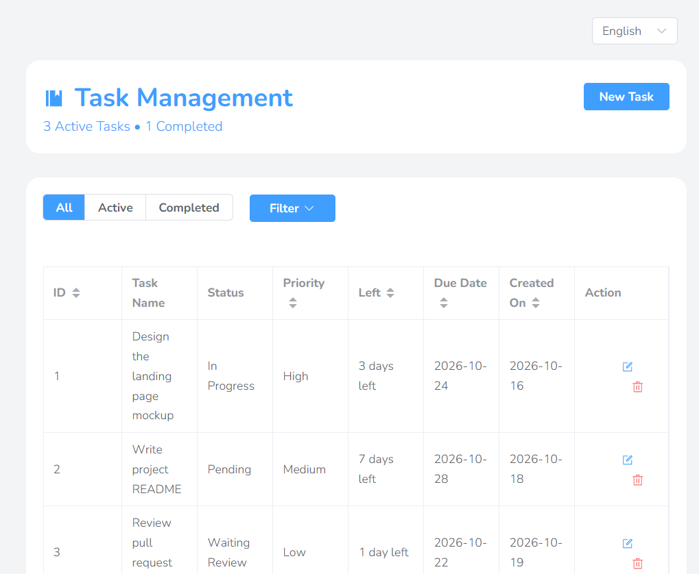
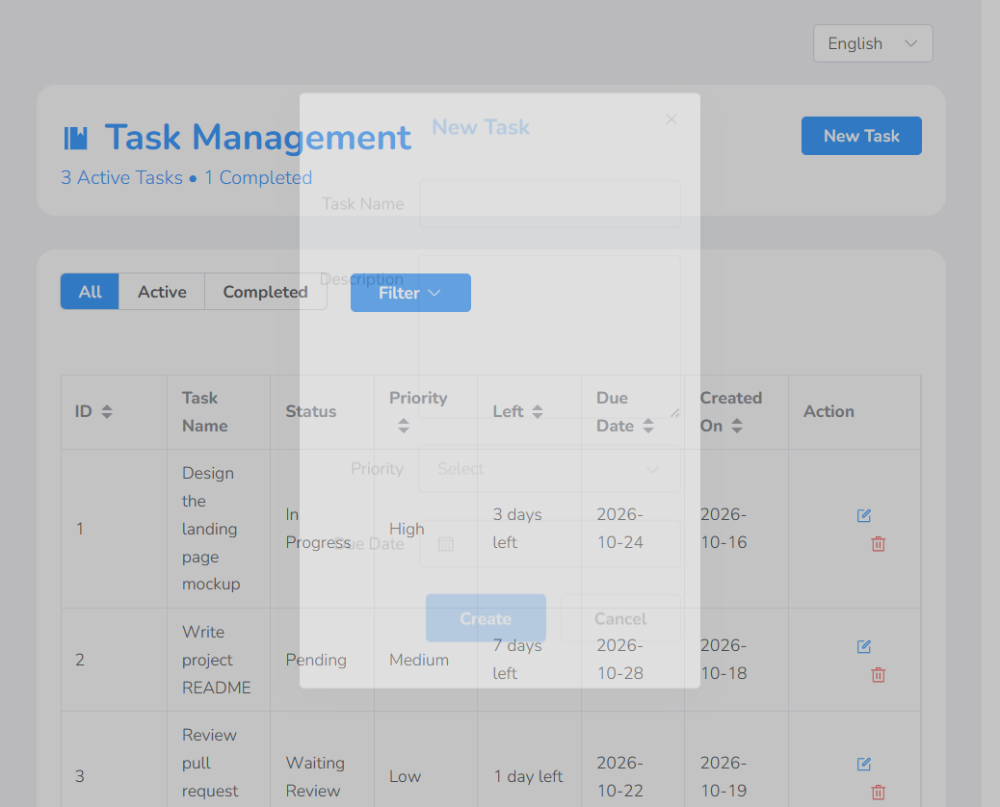

# Task Management

[](https://vuejs.org/)
[](https://vite.dev/)
[](https://element-plus.org/)
[](https://tanstack.com/query)
[](LICENSE)
[](https://github.com/mavisw10/task-management/actions/workflows/deploy.yml)


A full-stack task manager built with **Vue 3 + Vite** and an **Express** API. Create, edit, filter and track tasks with live counters, due-date countdowns and English/中文 localization — try the [live demo](https://mavisw10.github.io/task-management/), which runs entirely in your browser (no server required).



## Features

- **Create / edit / delete tasks** — dialog-based forms with validation, plus a confirmation prompt before deleting
- **Live counters & views** — active/completed counts update instantly, with All / Active / Completed tabs
- **Due-date countdowns** — "3 days left", "1 day left", "Due today", "3 days overdue" (all localized), with past dates disabled in the pickers
- **Filtering** — keyword search combined with status, priority and date filters
- **i18n** — full English and Simplified Chinese UI
- **Works with or without a backend** — talks to the Express API when it is reachable and transparently falls back to `localStorage`, so the [GitHub Pages demo](https://mavisw10.github.io/task-management/) keeps full CRUD without a server



## Tech stack

| Layer | Tools |
| --- | --- |
| Frontend | Vue 3 (Composition API, `<script setup>`), Vite 8, Tailwind CSS 4 |
| UI | Element Plus, @element-plus/icons-vue |
| Data fetching | TanStack Query (vue-query), Axios |
| i18n | vue-i18n |
| Backend | Node.js + Express (in-memory store) |
| CI/CD | GitHub Actions → GitHub Pages |

## Getting started

### Frontend

```bash
npm install
npm run dev        # http://localhost:5173
```

### Backend API (optional)

```bash
cd backend
npm install
npm run start      # http://localhost:3000
```

With the API running, the frontend (in dev mode) uses it automatically; stop the API and everything keeps working against `localStorage`. Point the frontend at a specific API with `VITE_API_URL`:

```bash
VITE_API_URL=http://localhost:3000 npm run dev
```

### Production build

```bash
npm run build      # outputs dist/
npm run preview    # serve the build locally
```

## Project structure

```
├── backend/
│   └── server.js            # Express REST API (in-memory store)
├── docs/screenshots/        # README screenshots
├── src/
│   ├── api/taskApi.js       # data layer: API with localStorage fallback
│   ├── App.vue              # task list, filters, dialogs, counters
│   ├── enum/                # status & priority enums
│   ├── locales/             # en-US / zh-CN translations
│   ├── query/               # vue-query hooks (list/create/update/delete)
│   └── utils/               # date helpers
└── .github/workflows/       # Pages deploy pipeline
```

### API endpoints

| Method | Endpoint | Purpose |
| --- | --- | --- |
| GET | `/get-task-list` | List tasks (keyword, status, priority, date filters) |
| POST | `/create-task` | Create a task |
| PUT | `/update-tasks/:id` | Update a task |
| DELETE | `/remove-tasks/:id` | Delete a task |
